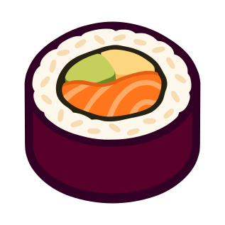

 ![Version][versionimage]       

[versionimage]: https://img.shields.io/github/v/release/TheHumanDev/Sushi?color=%23aa0077&include_prereleases&logo=

 
# Sushi

Sushi is an experimental strongly-typed systems programming language focused on memory safety,
predictable behavior, and minimizing footguns while still providing the control and structure
expected from low-level software development.

The documentation for Sushi can be found [here](https://sushilang.readthedocs.io/en/latest/).
